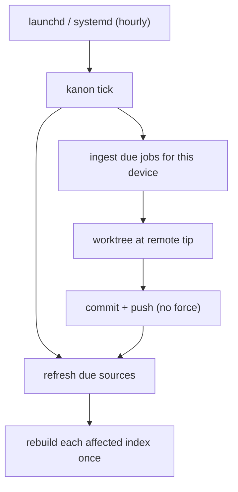

# Architecture

Kanon composes three layers. The knowledge core does not know about Cursor,
Claude, Gemini, Codex, or any other runtime.

1. **Sources** — Git checkouts or local directories with a `kanon.yml`.
   Markdown in declared roots is the source of truth.
2. **Indexes** — one QMD SQLite file per index, built from one or more
   sources. Rebuildable. Never synced through Git.
3. **Operations** — a never-rest contract (`search`, `get`, `status`,
   `listIndexes`) used by the CLI, the TypeScript API, and optional MCP.

## Access

A **project** is a named caller with a root path. **Grants** map a project
to index ids. Grants live only in machine config. A source repo cannot grant
itself roots, remotes, or index access.

The MCP process opens *only* the granted index files. A filtering bug in
QMD cannot see an ungranted index.

## Transports

| Caller | Transport | Principal |
| --- | --- | --- |
| Human operator | CLI → `createLocalClient` | `operator` (all configured indexes) |
| Agent | `kanon mcp --project <id>` | that project |
| In-process | TypeScript API | supplied by the host |

HTTP is deferred.

## Scheduled jobs

The operating system fires `kanon tick` every hour (a launchd LaunchAgent on
macOS, a systemd user timer on Linux). Each tick takes a lock, reads machine
config and job state, and runs whatever is due:

- **Refresh** (every source with `refresh` other than `off`). Managed
  sources run `git ls-remote` against the configured remote and
  fast-forward when the head moved. Local sources are rescanned and compared
  with the index catalogue by path and content hash; they are never fetched.
- **Ingest** (jobs for this device). A connector lists and reads Markdown.
  Each document is placed in one circle on the job's `route`, then mirrored
  into that circle's worktree, committed and pushed only after an audience
  check. See [ADR 0006](./decisions/0006-connectors-land-as-markdown-in-git.md)
  and [ADR 0008](./decisions/0008-circles-of-trust.md).
  By hand, ingest is two steps: `kanon ingest scan` lists sharing and
  eligible circles without downloading, then `kanon ingest run --from-scan`
  downloads from it, optionally in batches.

Each affected index is rebuilt once per tick. Cadence lives only in config,
so changing it needs no reinstall. Jobs are reachable through the CLI and
SDK only.

Connectors are plain objects of functions (`list`, `read`, and optionally
`sharing`, `canShare`, `account`) behind `createConnector`. Google Drive is
the only kind today. Items without a Markdown form are skipped as
`unsupported_format`; that is where converters and other stores plug in.

## Search modes

`lexical`, `semantic`, and `hybrid`. The mode actually used is returned on
every result. Offline, lexical still works; semantic/hybrid fail explicitly
or the caller chooses lexical.
